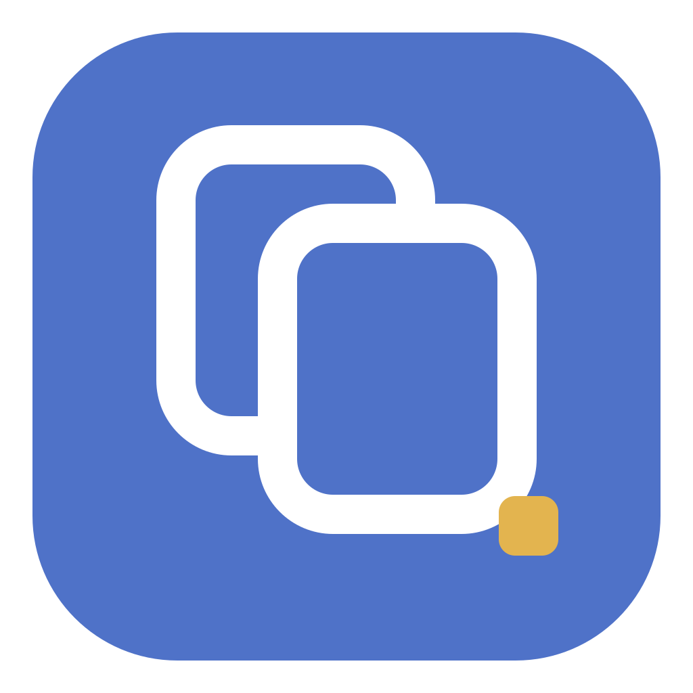
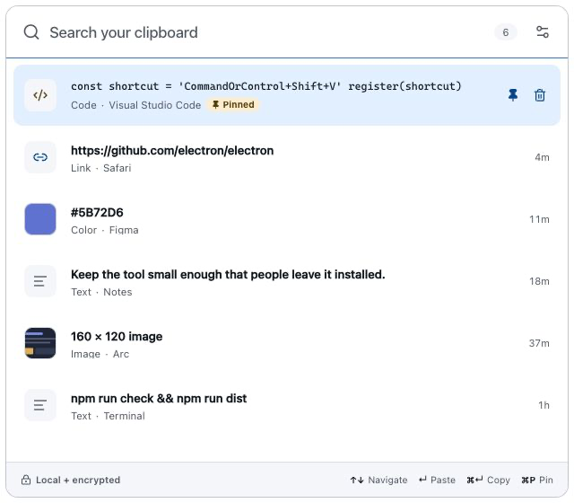

<p align="center">
  
</p>

<h1 align="center">Keypt</h1>

<p align="center"><strong>Your clipboard, one shortcut back.</strong></p>

<p align="center">
  A tiny, local, encrypted clipboard history for macOS and Windows.<br>
  No account. No sync. No telemetry. No dashboard.
</p>

<p align="center">
  
  
  
  <a href="https://github.com/AmoonPod/keypt/actions/workflows/ci.yml"></a>
  <a href="https://github.com/AmoonPod/keypt/actions/workflows/codeql.yml"></a>
  <a href="https://github.com/AmoonPod/keypt/releases"></a>
  <a href="LICENSE"></a>
</p>

<picture>
  <source media="(prefers-color-scheme: dark)" srcset="docs/screenshots/panel-dark.png">
  <source media="(prefers-color-scheme: light)" srcset="docs/screenshots/panel-light.png">
  
</picture>

> [!NOTE]
> Keypt is at `0.1.0`: the application, tests, packaging, and release automation are complete, but public release binaries still need maintainer signing credentials before the first tag is published.

## The product

Press <kbd>⌘⇧V</kbd> on macOS or <kbd>Ctrl+Shift+V</kbd> on Windows. Keypt opens above the app you are using with search already focused. Pick a recent item and press <kbd>Enter</kbd> to paste it.

Click an item to copy it without pasting; Keypt closes so you can paste normally with <kbd>⌘V</kbd> or <kbd>Ctrl+V</kbd>.

That is the whole product.

- Text, links, code, colors, and images
- Instant in-memory search over local history
- Keyboard navigation, copy, paste, pin, delete, and clear
- Source application and copied time without noisy metadata
- System, light, and dark themes
- Menu-bar app on macOS; system-tray app on Windows
- Configurable retention, history limits, excluded apps, pause, and launch at login
- Signed in-app updates with explicit download and restart controls
- No main window, account, cloud sync, collaboration, AI, or telemetry

## Keyboard

| Action                     | macOS                       | Windows                               |
| -------------------------- | --------------------------- | ------------------------------------- |
| Open Keypt                 | <kbd>⌘⇧V</kbd>              | <kbd>Ctrl+Shift+V</kbd>               |
| Move selection             | <kbd>↑</kbd> / <kbd>↓</kbd> | <kbd>↑</kbd> / <kbd>↓</kbd>           |
| Paste or configured action | <kbd>Enter</kbd>            | <kbd>Enter</kbd>                      |
| Copy without pasting       | <kbd>⌘ Enter</kbd>          | <kbd>Ctrl+Enter</kbd>                 |
| Pin or unpin               | <kbd>⌘P</kbd>               | <kbd>Ctrl+P</kbd>                     |
| Delete selected item       | <kbd>⌘⌫</kbd>               | <kbd>Ctrl+Backspace</kbd>             |
| Clear unpinned history     | <kbd>⌘⇧⌫</kbd> twice        | <kbd>Ctrl+Shift+Backspace</kbd> twice |
| Open settings              | <kbd>⌘,</kbd>               | <kbd>Ctrl+,</kbd>                     |
| Clear search / close       | <kbd>Esc</kbd>              | <kbd>Esc</kbd>                        |

The global shortcut and Enter behavior are configurable. If automatic paste is unavailable, Keypt still copies the selected item and explains why.

## Privacy by behavior

Clipboard history never leaves the device. Keypt has no telemetry SDK, account system, sync service,
or remote content. Its main process contacts only GitHub's HTTPS release endpoints to check and
download signed application updates; the packaged renderer still receives a `connect-src 'none'`
Content Security Policy and cannot make network requests.

- History index, search text, previews, thumbnails, and payloads are encrypted with AES-256-GCM.
- The random master key is wrapped by Electron `safeStorage`, backed by Keychain on macOS and DPAPI on Windows.
- Writes use a temporary file, flush, atomic rename, and user-only filesystem permissions where the OS supports them.
- Concealed, transient, auto-generated, 1Password, and Windows “do not include in history” clipboard markers are skipped.
- Common password managers are excluded by default. Frontmost-app exclusions match name, bundle/process ID, and executable path; private clipboard markers remain the stronger protection.
- Text over 1 MiB and images over 20 MiB are ignored. Retention runs on startup, after setting changes, and every 30 minutes.
- Capture stops while the screen is locked or the computer is suspended.

No desktop clipboard API can reliably tell whether ordinary text copied from a browser came from a password field. Source-app detection is also sampled after a clipboard change, so switching apps immediately can misattribute a copy. If that distinction matters, exclude the browser or pause capture. See the full [security model](docs/SECURITY.md).

## Platform behavior

| Concern             | macOS                                                       | Windows                                                          |
| ------------------- | ----------------------------------------------------------- | ---------------------------------------------------------------- |
| Presence            | Menu-bar template icon; Dock hidden                         | System-tray monochrome icon; taskbar skipped                     |
| Panel               | Native panel behavior, visible across spaces/full-screen    | Frameless always-on-top utility window                           |
| Source app          | `lsappinfo` for frontmost bundle metadata                   | Foreground window PID resolved through a fixed PowerShell script |
| Automatic paste     | Requires Accessibility permission; sends only <kbd>⌘V</kbd> | Uses the built-in .NET `SendKeys` <kbd>Ctrl+V</kbd> path         |
| Secure key wrapping | macOS Keychain through `safeStorage`                        | DPAPI through `safeStorage`                                      |
| Launch at login     | Electron login item                                         | Electron login item                                              |

The application currently targets macOS and Windows only. Linux-specific behavior is intentionally not claimed or packaged.

## Run from source

Requirements:

- Node.js `20.19+` or `22.12+`
- npm
- macOS or Windows for native clipboard behavior

Clone this repository or your fork, then run:

```bash
npm ci
npm run dev
```

The renderer also has a safe demo mode for visual work:

```bash
npm run dev:renderer
```

It uses generated example data and never touches the system clipboard.

## Verify

```bash
npm run check       # TypeScript, ESLint, unit tests, formatting
npm run build       # Production main, preload, and renderer bundles
npm run test:e2e    # Launches Electron through the sandboxed preload bridge
```

The E2E test verifies search and theme behavior, then inspects the on-disk vault to confirm its `KYPT2` context-bound authenticated-encryption envelope does not contain the seeded clipboard plaintext.

## Package

Build an unpacked application for the current platform:

```bash
npm run package
```

Build distributable artifacts (`.dmg` and `.zip` on macOS; NSIS `.exe` and `.zip` on Windows):

```bash
npm run dist
```

On a development Mac with a certificate in Keychain, electron-builder may discover it automatically. To make an explicitly unsigned local verification build:

```bash
CSC_IDENTITY_AUTO_DISCOVERY=false npm run package
```

Artifacts are written to `release/`. Semantic `v*.*.*` tags run the [release workflow](.github/workflows/release.yml), which creates signed macOS x64/arm64 and Windows x64 artifacts, updater manifests, checksums, SBOMs, and provenance attestations before atomically publishing one [GitHub Release](https://github.com/AmoonPod/keypt/releases). Signing secret names and the release process are documented in [Releasing](docs/RELEASING.md).

## Architecture

Keypt uses three strict process layers:

```text
React renderer  →  typed contextBridge API  →  validated IPC  →  Electron main process
                                                                ├─ clipboard monitor
                                                                ├─ encrypted repository
                                                                ├─ signed release updater
                                                                └─ native tray/paste adapters
```

The renderer has no Node.js access. Context isolation and Chromium sandboxing are enabled, IPC payloads and responses are validated with Zod, navigation and permissions are denied, and packaged DevTools are disabled. Read [Architecture](docs/ARCHITECTURE.md) for the data flow and [Security](docs/SECURITY.md) for trust boundaries and limitations.

## Repository map

```text
src/main/        privileged Electron lifecycle, clipboard, persistence, native behavior
src/preload/     narrow typed contextBridge implementation
src/renderer/    React panel and settings UI
src/shared/      schemas, contracts, search, and shared types
tests/unit/      crypto, repository, classifier, shortcut, search, and UI tests
tests/e2e/       real Electron boundary and encrypted-vault test
assets/          editable brand and tray SVG sources
build/           generated package icons and macOS entitlements
docs/            architecture, security, brand, release notes, and screenshots
scripts/         deterministic icons, build budgets, and release verification
.github/         issue forms, CI, security analysis, dependency review, and release automation
```

## Product boundaries

The scope is intentionally hard to expand. A proposed feature should make the shortcut-to-paste loop faster, safer, or more predictable. Accounts, sync, AI, collaboration, collections, rich editing, a main dashboard, and clipboard analytics are out of scope. See [PRODUCT.md](PRODUCT.md) and [DESIGN.md](DESIGN.md).

## Contributing

Bug fixes, platform correctness, privacy hardening, accessibility, performance work, and restrained UX refinements are welcome. Read [CONTRIBUTING.md](CONTRIBUTING.md) before opening a pull request. Security reports belong in a private GitHub security advisory; see [SECURITY.md](SECURITY.md). General reporting boundaries are in [SUPPORT.md](SUPPORT.md).

Keypt is available under the [MIT License](LICENSE). Packaged dependency licenses are indexed in
[third-party notices](THIRD_PARTY_NOTICES.md).
