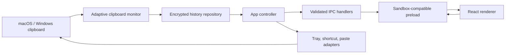

# Keypt architecture

Keypt is a single-purpose Electron application with a privileged main process, a sandboxed renderer, and a narrow preload bridge. Clipboard data is plaintext only while it is needed in process memory; every history artifact written to disk is authenticated and encrypted.

## Process boundaries



| Layer            | Trust and responsibility                                                                                                                 |
| ---------------- | ---------------------------------------------------------------------------------------------------------------------------------------- |
| Main process     | Owns clipboard access, files, encryption keys, shortcut registration, tray/menu, permissions, source-app detection, and paste injection. |
| Preload          | Exposes one frozen-shape `window.keypt` API through `contextBridge`; validates responses before handing them to the renderer.            |
| Renderer         | Displays already-sanitized data and requests typed actions. It has no Node.js, filesystem, shell, clipboard, or arbitrary IPC access.    |
| Shared contracts | Defines Zod schemas and TypeScript types used on both sides of the boundary.                                                             |

The main process accepts an IPC request only when its sender is the one Keypt panel `webContents`. Every input is parsed again in the main process; renderer-side types are developer ergonomics, not a security boundary.

## Startup and lifetime

1. Electron enables Chromium sandboxing and takes a single-instance lock.
2. The default session denies all permission checks and requests. Packaged responses receive the strict production CSP.
3. Settings load, the OS-wrapped master key is recovered or created, and encrypted history is opened.
4. Retention is applied before the UI starts. Orphaned encrypted payloads from interrupted writes are removed.
5. The hidden panel, global shortcut, and tray/menu are created.
6. Clipboard monitoring starts unless the test harness is active.
7. Lock and suspend events stop monitoring; unlock and resume restart it.

Closing or blurring the panel hides it. The tray/menu process remains alive until the explicit Quit command.

## Clipboard capture

The monitor polls because Electron does not expose a cross-platform clipboard-change event. The interval adapts to activity:

| State                                           | Interval |
| ----------------------------------------------- | -------: |
| First 30 seconds after startup or explicit wake |   400 ms |
| Clipboard changed within 2 minutes              |   650 ms |
| Changed within 10 minutes                       |    1.2 s |
| Quiet for more than 10 minutes                  |      2 s |
| System idle for more than 60 seconds            |    2.5 s |

Each pass only reads clipboard formats and content. Source-app discovery and persistence happen only after a new payload digest is found, avoiding repeated process queries and disk writes while idle. Timers are unreferenced so they cannot keep shutdown alive.

Capture order and guards:

1. Skip when paused.
2. Read available formats and reject concealed, transient, auto-generated, password-manager, or Windows history-exclusion markers.
3. Prefer a real image when image formats are present; otherwise read text.
4. Reject empty and oversized payloads.
5. Hash the payload and ignore unchanged or app-authored clipboard content.
6. Resolve the frontmost source app and apply case-insensitive exclusions to name, ID, and path.
7. Classify text as link, code, color, or plain text; create a compact image thumbnail where applicable.
8. Encrypt and persist, then broadcast a new immutable snapshot.

The repository also deduplicates matching payloads: copying the same value moves the existing item to the current time instead of creating another row.

## Storage format

The vault lives below Electron's platform `userData` directory and can be opened from Settings. Its logical layout is:

```text
vault/
  master-key.safe       OS-encrypted 32-byte master key
  preferences.json      non-sensitive settings only
  history.index         encrypted metadata, preview, and search index
  payloads/
    <uuid>.clip          encrypted text or PNG payload
```

`history.index` and every `.clip` file use the same binary envelope:

```text
KYPT2 | 12-byte random IV | 16-byte GCM authentication tag | ciphertext
```

Encryption is AES-256-GCM with the magic/version bytes, file role, and item UUID as additional authenticated data. A fresh IV is generated for every write. Decryption rejects an unknown header, truncated envelope, wrong key, moved payload, or modified ciphertext; payload plaintext is also checked against the SHA-256 digest stored in the authenticated index.

The 256-bit master key is random. Electron `safeStorage` wraps it with Keychain on macOS and DPAPI on Windows. If OS secure storage is unavailable, Keypt refuses to save history instead of falling back to a hard-coded or plaintext key.

Writes are serialized through a mutation queue. Each file is written to a sibling temporary file, flushed, atomically renamed, and restricted to the current user where supported. New payloads land before the index commit; if the process stops between those operations, startup orphan cleanup removes the unreferenced ciphertext. Deleted payload cleanup is retried after a later launch if the filesystem rejects removal.

## Search and activation

Search runs synchronously over the in-memory snapshot so typing does not cross IPC or touch disk. The scoring favors exact/prefix preview matches, then substring matches across preview, type, source app, and search text; pinned state and recency resolve ties.

Activation stays in the main process:

1. Decrypt the selected payload.
2. Write text or image to the OS clipboard.
3. Suppress the app-authored digest so monitoring does not recapture it.
4. Refresh its timestamp and persist the encrypted index.
5. Hide the panel.
6. For paste mode, wait briefly for focus to return and send the platform paste chord.

macOS asks for Accessibility access because `System Events` sends Command-V. Windows uses a fixed non-interactive PowerShell invocation of .NET `SendKeys`. If paste is unavailable or fails, the clipboard write still succeeds and the panel reports the limitation.

## Platform adapters

Platform differences are kept at the edges:

- `tray.ts` chooses a macOS template icon and menu-bar conventions or a Windows tray icon/menu.
- `panel-window.ts` selects macOS panel behavior and cross-space visibility while using a taskbar-skipping utility window on Windows.
- `source-app.ts` invokes fixed OS binaries with fixed argument arrays—never a constructed shell command.
- `paste.ts` owns platform permission and keystroke behavior.
- `app.setLoginItemSettings` is called only in a packaged app.

No native Node module is required, keeping x64/arm64 packaging deterministic.

## Application updates

The main-process `UpdateManager` checks only the fixed public `AmoonPod/keypt` GitHub Releases feed.
It is disabled in development and on unsupported platforms, rejects downgrades, and uses an explicit
state machine shared through validated IPC. Downloads and restart-to-install are always initiated by
the user; update payloads are validated by release metadata plus macOS/Windows code signatures.

The renderer cannot configure a feed URL or make network requests. Release jobs publish
`latest-mac.yml`/`latest.yml`, required ZIP or NSIS blockmaps, checksums, SBOMs, and provenance only
after both native builds pass.

## Verification strategy

- Unit tests cover authenticated encryption and tamper rejection, text classification, ranking, shortcut validation, source exclusion, repository retention/deduplication/concurrency, and renderer behavior.
- The Electron E2E test launches the compiled application through the real sandboxed preload, exercises the UI, then verifies the vault header and absence of seeded plaintext.
- CI runs the full static/unit gate on Linux and native E2E plus unpacked packaging on macOS and Windows.
- Release jobs build on the target operating system. macOS produces x64 and arm64 artifacts; Windows
  produces x64 NSIS and zip artifacts. Both packaged apps, signatures, updater manifests, checksums,
  SBOMs, and provenance are verified before a draft release is made public.

See [SECURITY.md](SECURITY.md) for the threat model and [RELEASING.md](RELEASING.md) for signing and publication.
